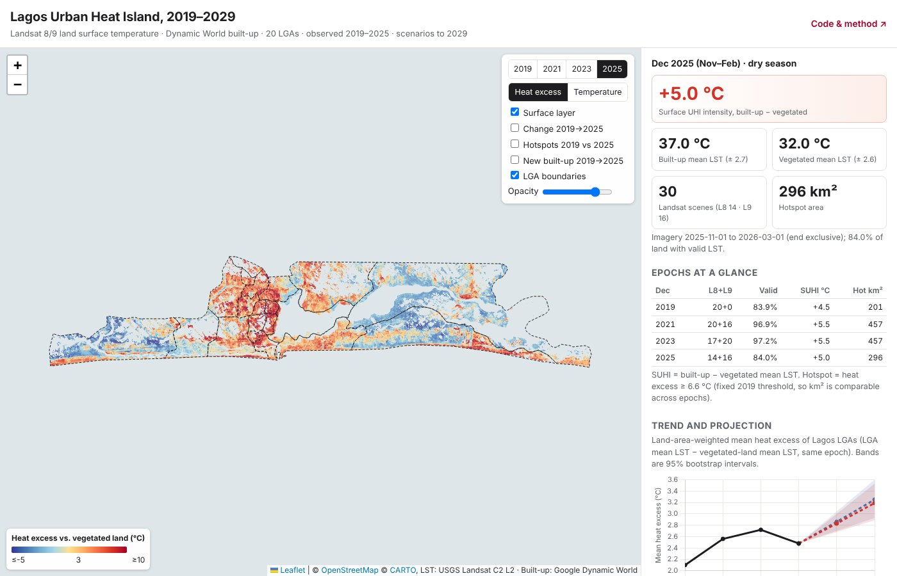
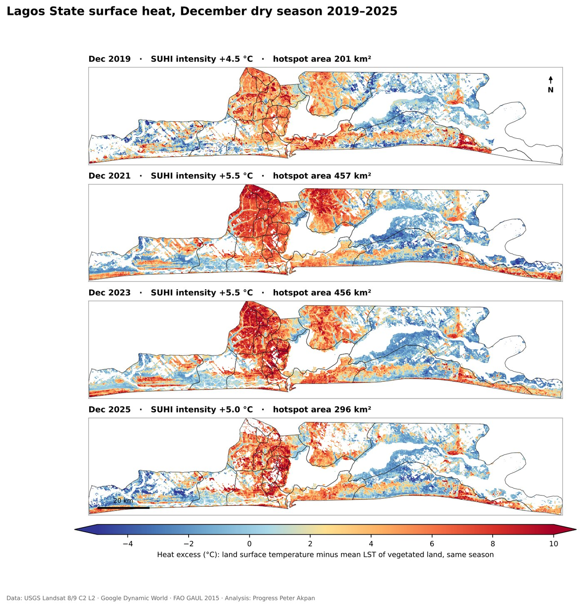
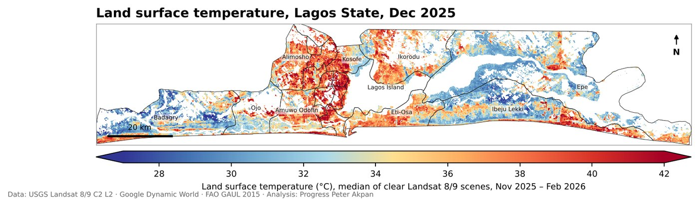
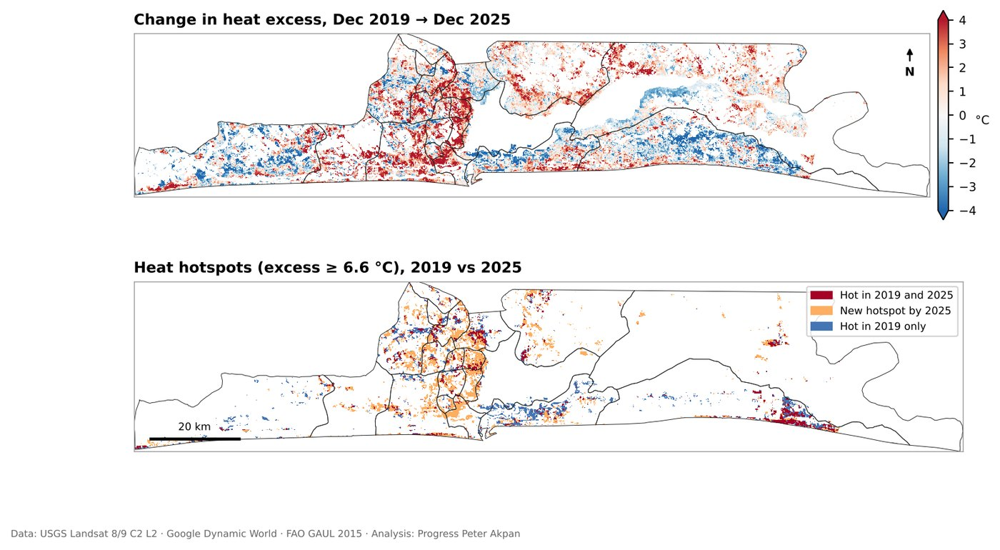
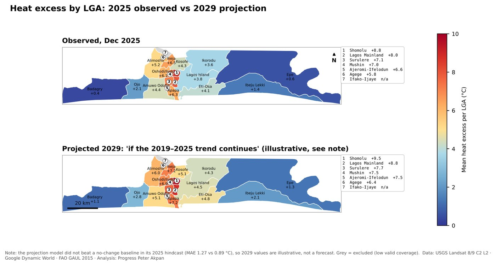
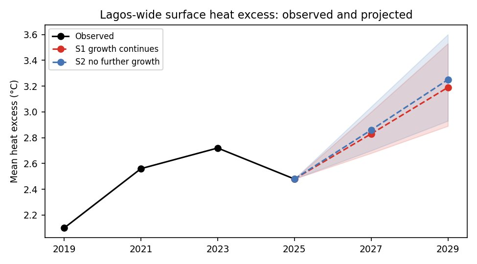
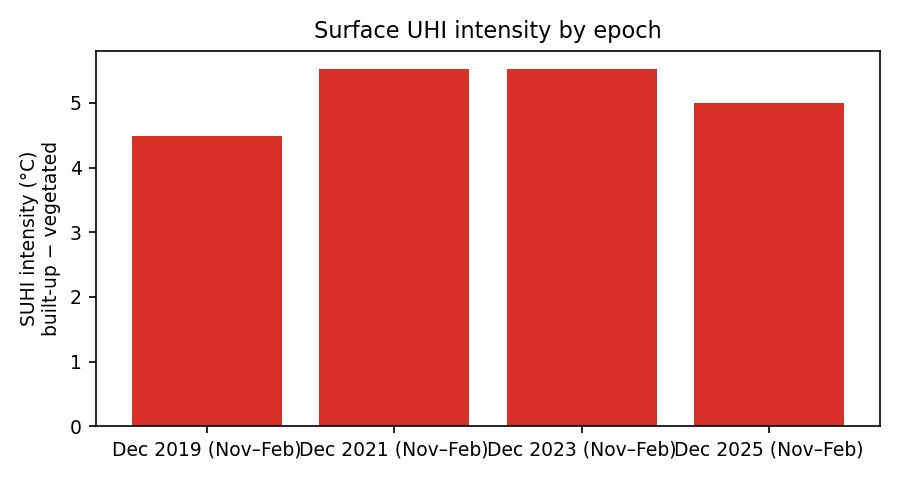
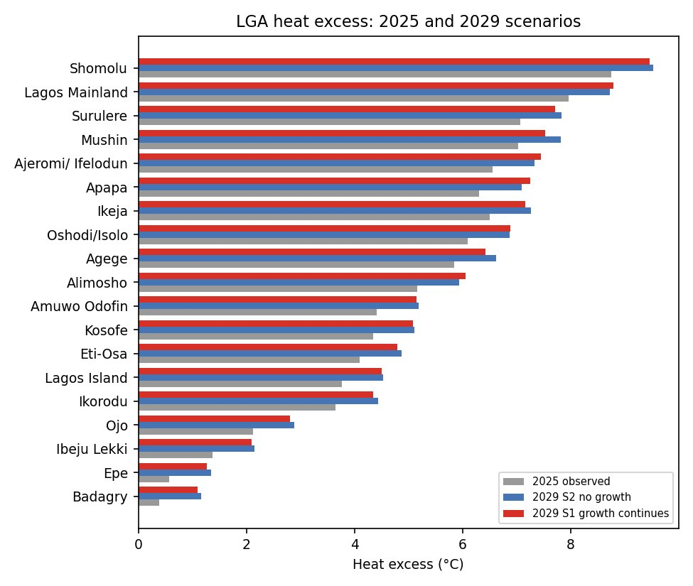
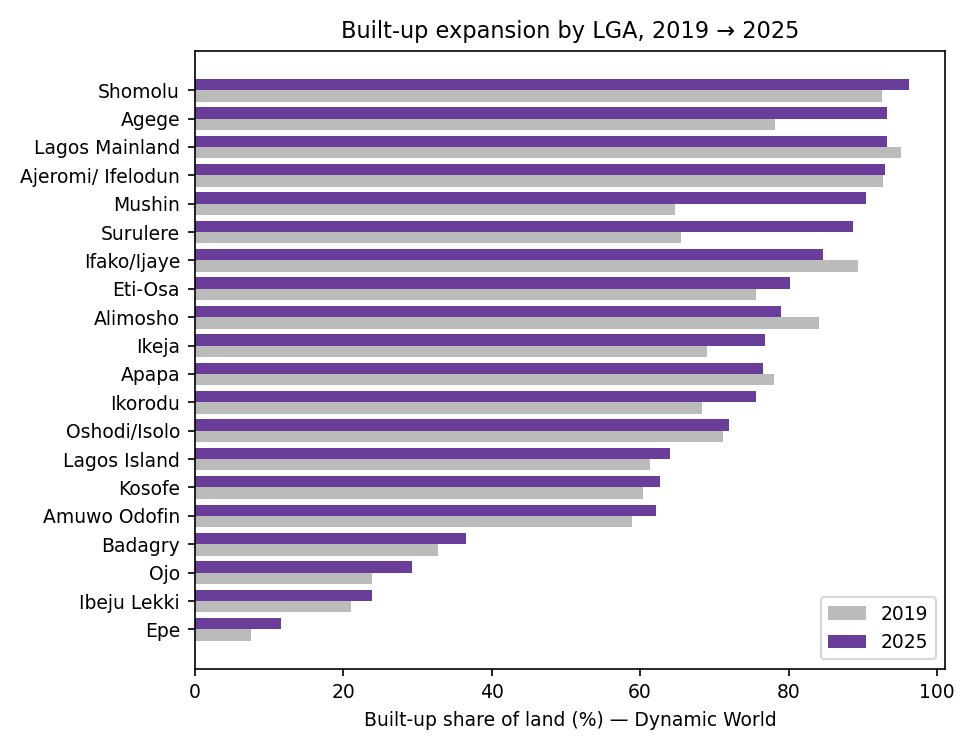

# Lagos Urban Heat Island, 2019–2029: Observed Trend and Scenario Projections

**Live Demo:** [Interactive map](https://progress-akpan-portfolio.vercel.app/projects/urban-heat-island-lagos/map/) (mirror on [GitHub Pages](https://progress-peter.github.io/urban-heat-island-lagos/)) · **Case study:** [progress-akpan-portfolio.vercel.app](https://progress-akpan-portfolio.vercel.app/projects/urban-heat-island-lagos/) · **Notebook:** [`notebooks/lagos_uhi_lst.ipynb`](notebooks/lagos_uhi_lst.ipynb)



*Screenshot taken from a local preview, so the basemap tiles are missing; the live map shows them.*

## Overview
This project measures how the **surface urban heat island (SUHI)** of Lagos State has changed every two years. Four observed epochs (Dec 2019, 2021, 2023 and 2025) come from Landsat 8/9 land surface temperature (LST). The change is linked to built-up expansion mapped with Google Dynamic World, and heat is projected to **2027 and 2029** under two scenarios: built-up growth continuing at each LGA's observed rate, or no further growth. The analysis runs in Google Earth Engine (Python API) and is published as an interactive Leaflet web map.

## Problem statement
Lagos is one of Africa's fastest-growing megacities. Wetlands, farmland and tree cover on its fringes (Lekki–Ibeju-Lekki, Ikorodu, Alimosho, the Badagry axis) are being converted to buildings and paved surfaces, which absorb and re-radiate more heat than vegetated ground. A single heat map shows where it is hot today. It cannot show whether the heat island is intensifying, which LGAs are warming fastest, or what continued expansion would mean by the end of the decade. Planners need that trend, and a defensible projection, to decide where to protect green space, plant trees or apply cool-surface measures.

## Objectives
1. Map December dry-season LST for Lagos State in 2019, 2021, 2023 and 2025 at 30 m.
2. Measure SUHI intensity, LGA-level **heat excess** and hotspot area in each epoch, and the change in hotspots and built-up land from 2019 to 2025.
3. Estimate how much heat excess rises with built-up expansion and with time. Project 2027 and 2029 under "growth continues" and "no further growth" scenarios, with uncertainty and a hindcast accuracy check.
4. Publish the results as an open, interactive web map.

## Study area
Lagos State, south-west Nigeria: about 3,577 km² across 20 Local Government Areas. The state runs from the dense urban core (Lagos Island, Lagos Mainland, Surulere, Mushin, Oshodi-Isolo, Ikeja) to fast-growing fringes (Eti-Osa, Ibeju-Lekki, Ikorodu, Alimosho) and largely rural Epe and Badagry, with extensive lagoons, mangroves and wetlands. LGA boundaries are from FAO GAUL 2015.

## Data & sources
| Dataset | Source | Date | Resolution | Format |
|---|---|---|---|---|
| Landsat 8 C2 L2 (`ST_B10`, `SR_B4`, `SR_B5`, `QA_PIXEL`) | USGS, via Earth Engine `LANDSAT/LC08/C02/T1_L2` | Nov–Feb windows below | 30 m (thermal 100 m native) | EE image collection |
| Landsat 9 C2 L2 (same bands) | USGS, via Earth Engine `LANDSAT/LC09/C02/T1_L2` | Available from early 2022 | 30 m (thermal 100 m native) | EE image collection |
| Dynamic World V1 (annual mode of `label`) | Google / WRI, via Earth Engine `GOOGLE/DYNAMICWORLD/V1` | Calendar years 2019, 2021, 2023, 2025 | 10 m | EE image collection |
| FAO GAUL 2015 level 1 & 2 | FAO, via Earth Engine | 2015 | Vector | Feature collection |
| Basemap | Esri World Light Gray Canvas (© Esri, HERE, Garmin, © OpenStreetMap contributors) | current | Tiles | XYZ |

**Epochs**

| Epoch | Imagery window (end exclusive) | Status |
|---|---|---|
| 2019 | 1 Nov 2019 – 1 Mar 2020 | observed (baseline) |
| 2021 | 1 Nov 2021 – 1 Mar 2022 | observed |
| 2023 | 1 Nov 2023 – 1 Mar 2024 | observed |
| 2025 | 1 Nov 2025 – 1 Mar 2026 | observed |
| 2027 | n/a | projected |
| 2029 | n/a | projected |

All observed epochs use the same December-centred dry season, which keeps them directly comparable. No raw imagery is stored in this repository; only derived, web-ready outputs (`docs/data/`) are included.

## Methodology
1. **LST:** `LST(°C) = ST_B10 × 0.00341802 + 149.0 − 273.15`. Collection 2 Level-2 already includes atmospheric and emissivity correction.
2. **Masking and compositing:** pixels flagged in `QA_PIXEL` bits 0–4 (fill, dilated cloud, cirrus, cloud, shadow) are removed, as are values outside 10–70 °C. Scenes with ≥ 40% cloud cover are excluded, and pixels need ≥ 3 clear observations. A per-pixel median is taken for each epoch. Water is masked with a fixed land mask: pixels that are land in every Dynamic World year.
3. **Land cover per epoch:** annual mode of Dynamic World labels gives built-up (class 6) and the vegetated reference (trees, grass, crops, shrub & scrub). Flooded vegetation is excluded from the reference.
4. **Heat excess** = mean LST of an area − mean LST of vegetated land in the same epoch. Both terms come from the same images, so year-to-year weather largely cancels. This makes heat excess the comparable quantity across years. Raw LST is not. **SUHI intensity** is the heat excess of all built-up pixels.
5. **Hotspots:** heat excess ≥ the 2019 90th percentile. The threshold is fixed, so hotspot km² is comparable across epochs. Maps show persistent, new and lost hotspots between 2019 and 2025.
6. **Model:** an LGA × year panel (2019–2025) fitted with LGA fixed effects:
   `heat_excess(i,t) = α_i + β·built_share(i,t) + γ·year + ε`.
   - β = warming from built-up expansion.
   - γ = background drift not explained by expansion (densification, tree loss inside built areas, roofing materials).
   Only LGAs with ≥ 30% valid pixels in all four epochs are used.
7. **Scenarios** from each LGA's 2025 level:
   - **S1 growth continues:** built-up share keeps growing at the LGA's own 2019–2025 linear rate, so Δ = β·Δbuilt + γ·Δt.
   - **S2 no further growth:** built-up frozen at 2025, so Δ = γ·Δt.
8. **Uncertainty:** 95% intervals from 2,000 cluster-bootstrap draws that resample LGAs.
9. **Validation (hindcast):** the model is fitted on 2019–2023 only and used to predict 2025. Its mean absolute error across LGAs is compared with a naive "no change since 2023" baseline.

## Results
All values below come from the notebook run of 8 Nov 2026 (`docs/data/summary.json`, `docs/data/projections.json`).

### Maps


*Heat excess (LST minus mean LST of vegetated land) for each December epoch. The dense mainland core stays hottest throughout.*


*Land surface temperature, Dec 2025 (median of 30 clear Landsat 8/9 scenes).*


*Top: change in heat excess, 2019 → 2025. Bottom: hotspots that persisted, newly appeared or disappeared.*


*Mean heat excess per LGA, observed 2025 vs. the illustrative 2029 trend extrapolation.*

### Statistics

| Metric | Dec 2019 | Dec 2021 | Dec 2023 | Dec 2025 |
|---|---|---|---|---|
| Landsat scenes (L8 + L9) | 20 + 0 | 20 + 16 | 17 + 20 | 14 + 16 |
| Valid land coverage | 83.9% | 96.9% | 97.2% | 84.0% |
| Built-up mean LST (°C) | 36.43 | 37.14 | 37.47 | 37.04 |
| Vegetated mean LST (°C) | 31.94 | 31.62 | 31.94 | 32.04 |
| **SUHI intensity (°C)** | **+4.49** | **+5.52** | **+5.53** | **+5.00** |
| Hotspot area (km², heat excess ≥ 6.62 °C) | 200.6 | 456.6 | 456.5 | 295.5 |
| Lagos-wide mean heat excess (°C, 19 LGAs, area-weighted) | 2.10 | 2.56 | 2.72 | 2.48 |

**Hottest LGAs, Dec 2025 (heat excess vs. vegetated land):** Shomolu +8.75 °C, Lagos Mainland +7.96 °C, Surulere +7.06 °C, Mushin +7.03 °C, Ajeromi-Ifelodun +6.56 °C.
**Largest increase 2019 → 2025:** Lagos Mainland (+3.69 °C), Shomolu (+3.33 °C), Apapa (+2.34 °C), Oshodi-Isolo (+1.82 °C), Surulere (+1.57 °C), Amuwo Odofin (+1.50 °C).
**Coolest LGAs, Dec 2025:** Badagry (+0.39 °C), Epe (+0.57 °C), Ibeju-Lekki (+1.37 °C).

| Model / projection | Value |
|---|---|
| β, change in heat excess per +10 pp built-up share | −0.29 °C [95% CI −0.58, +0.01]: not distinguishable from zero |
| γ, background drift | +0.19 °C/yr [95% CI +0.11, +0.28] |
| Hindcast, fit 2019–2023 → predict 2025 (MAE across 19 LGAs) | model 1.27 °C vs. no-change baseline 0.89 °C: **the model does not beat the baseline** |
| Lagos-wide heat excess 2027: S1 / S2 | 2.83 [2.68, 3.00] / 2.86 [2.70, 3.04] °C |
| Lagos-wide heat excess 2029: S1 / S2 | 3.19 [2.89, 3.53] / 3.25 [2.93, 3.60] °C |

| | |
|---|---|
|  |  |
|  |  |

**Interpretation.**
- **Lagos has a strong and persistent surface heat island.** Built-up land was 4.5–5.5 °C hotter than vegetated land in every December epoch.
- **The heat is concentrated in the dense mainland core.** Shomolu, Lagos Mainland, Surulere, Mushin and Ajeromi-Ifelodun are all 6.5–8.8 °C above vegetated land. The lagoon-fringe and eastern LGAs (Epe, Ibeju-Lekki, Badagry) remain within about 1.5 °C of it.
- **SUHI intensity and hotspot area rose sharply from 2019 to 2021, held steady to 2023, then eased in 2025.** Hotspot area went from 201 km² to 457 km², stayed at 457 km², then fell to 296 km². The 2019 and 2025 epochs both had lower valid coverage (84% vs. 97%), and 2019 used Landsat 8 only, so part of the step change between epochs may reflect differences in image availability rather than surface change.
- **Warming within LGAs is not explained by Dynamic World built-up share.** β is near zero. The places that warmed most (Lagos Mainland, Shomolu, Apapa) were already more than 75% built-up in 2019, which points to densification inside the existing urban fabric rather than outward expansion. That is the background drift that γ captures.
- **The projections are an extrapolation, not a validated forecast.** S1 and S2 are nearly identical because β ≈ 0. Both extend the +0.19 °C/yr drift, putting Lagos-wide heat excess at about 3.2 °C by 2029. But the hindcast shows this trend model predicted 2025 worse than assuming no change, so the 2027/2029 values should be read as "if the 2019–2025 drift continues", not as an expected outcome.

## Limitations
- **Hindcast failure.** The trend model's 2025 prediction error (1.27 °C MAE) was larger than a no-change baseline (0.89 °C). With four epochs and one unusual year, the projections are illustrative only. Re-test them once Dec 2027 imagery is available (after Feb 2028).
- **Coverage differences between epochs.** 2019 and 2025 had about 84% valid land coverage, against about 97% in 2021 and 2023. Ifako-Ijaye fell below the 30% threshold in 2025 and is excluded from the model.
- **Bright sand and bare surfaces.** The ocean beach strip and dredged sand-fill sites (for example along the Lekki coast) show high LST without being urban. They raise hotspot counts in some coastal LGAs.
- **Surface, not air, temperature.** Landsat measures surface temperature at about 10:30 local time. Night-time heat retention is not captured.
- **Uneven sensors.** 2019 has Landsat 8 only, and 2021 is mostly Landsat 8. Later epochs combine Landsat 8 and 9, so they have more observations per pixel. Scene counts are reported for each epoch.
- **Harmattan haze.** December–February dust can bias LST slightly in some scenes. The median composite and the heat-excess metric limit, but do not remove, this.
- **Dynamic World noise.** Labels can flicker between years, especially on bare ground and construction sites. Annual mode composites reduce, but do not remove, this.
- **Thermal resolution and boundaries.** TIRS data is 100 m native, so small parks and streets are smoothed. GAUL 2015 LGA boundaries are approximate.

## Technologies
Google Earth Engine (Python API) · Python (NumPy, Matplotlib, Requests) · Google Colab · Leaflet 1.9.4 · Chart.js 4.4.1 · HTML/CSS/JavaScript · Vercel · GitHub Pages

## Reproducibility
1. Open `notebooks/lagos_uhi_lst.ipynb` in Google Colab.
2. Set `EE_PROJECT` to your non-commercial Earth Engine Cloud project ID. Epoch windows and thresholds are in the configuration cell.
3. Run all cells (about 10–20 minutes). Check the scene count and coverage printed for each epoch.
4. Unzip the downloaded `uhi_outputs.zip` into the repo root. This fills `docs/data/` and `results/figures/`.
5. Preview locally: `python -m http.server -d docs 8000` → http://localhost:8000
6. Deploy: push to GitHub → Settings → Pages → `main` branch, `/docs` folder.
7. Rebuild the static maps: `pip install matplotlib shapely pillow` then `python scripts/make_maps.py`.

The model code sits between `# --- MODEL START ---` and `# --- MODEL END ---` in `notebooks/lagos_uhi_lst.py`, a [jupytext](https://jupytext.readthedocs.io/) mirror of the notebook (`jupytext --to py:percent notebooks/lagos_uhi_lst.ipynb`). `python tests/test_model_synthetic.py` checks it on a synthetic panel with known coefficients; no Earth Engine is needed.

```
urban-heat-island-lagos/
├── notebooks/        lagos_uhi_lst.ipynb (+ .py mirror): Earth Engine pipeline and projection model
├── scripts/          make_maps.py: static map figures for this README
├── tests/            synthetic unit test for the projection model
├── docs/             GitHub Pages web map (index.html, app.js, style.css, vendor/, data/)
└── results/          maps/ and figures/ used in this README
```

## Author
**Progress Peter Akpan**, GIS & remote sensing analyst, Lagos, Nigeria · [Portfolio](https://progress-akpan-portfolio.vercel.app) · Part of a geospatial portfolio series.

**CV summary:** Quantified Lagos State's surface urban heat island across 20 LGAs (2019–2025) by processing 123 cloud-masked Landsat 8/9 thermal scenes and Dynamic World land cover in Google Earth Engine (Python); found built-up areas 4.5–5.5 °C hotter than vegetated land, hindcast-tested a projection model to 2029, and published the results as an interactive Leaflet web map.
